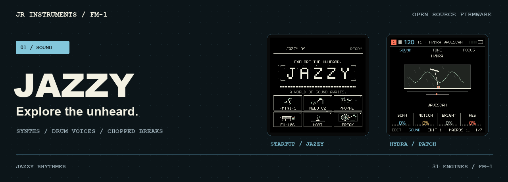
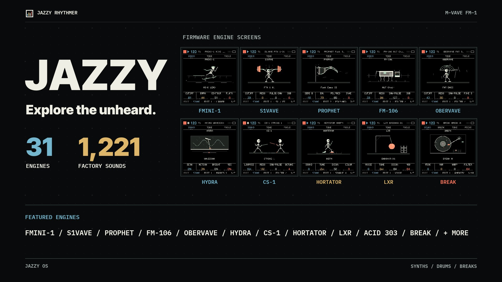

# JAZZY

**Explore the unheard.** Play a phrase on a new engine and see where it takes you. JAZZY turns the M‑VAVE FM‑1 into a sound exploration instrument with **31 engines and over 1,200 factory sounds**. Give each track one sound, then build a part around it.

[**Explore the engines**](https://jazzyrhythmer.github.io/Jazzy/#engines) · [**Play in your browser**](https://jazzyrhythmer.github.io/Jazzy/emulator/) · [**Install JAZZY**](https://jazzyrhythmer.github.io/Jazzy/installer/) · [Field manual](https://jazzyrhythmer.github.io/Jazzy/manual/) · [Releases](https://github.com/JazzyRhythmer/Jazzy/releases)

## Build 20261111.1 · Sidechain and Kick Link

Choose an internal kick, a track, USB audio or a matching MIDI note as the trigger. **Kick Link** lets one FM‑1 running JAZZY or RHYTHMER trigger ducking on the other. Set attack, release and amount in **FX → MASTER → DUCK ENV**.

This build also includes USB MIDI Host, 31 refreshed pixel scenes with individual backdrops, note-driven TRIO animation, and the earlier attack and mixer headroom fixes. [What’s new](https://jazzyrhythmer.github.io/Jazzy/#update) · [Sidechain and Kick Link guide](https://jazzyrhythmer.github.io/Jazzy/manual/#duck)

## The engine room

| FMINI-1 · Bass & leads | OberVave · Analog poly |
| --- | --- |
|  |  |
| Three-oscillator analog voicing, from rounded bass to sharper leads. | Resonant analog colours for keys, brass and moving pads. |
| **HYDRA · Digital textures** | **LXR · Drum synthesis** |
|  |  |
| Wavetable and mutation-inspired tones that shift under the fingers. | Browse individual voices drawn from 85 LXR factory sets. |

The GIFs show the firmware screens. [Hear the patches and drum demo on the website](https://jazzyrhythmer.github.io/Jazzy/#hear) or [browse all 31 engines](https://jazzyrhythmer.github.io/Jazzy/#engine-catalog).

## Put a sound in motion

- **One sound per track.** Browse analog, FM, wavetable and chip engines, or build a rhythm from individual HORTATOR, LXR and KW KICK voices.
- **Write a part.** Use the step sequencer and automation, draft a bass, chords and melody with GEN, or generate a pattern on a single drum track.
- **Chop a break.** Amen and Think occupy slots A and B, with slicing, rolls and sample switching.
- **Play with a setup.** Use a class-compliant controller over USB MIDI Host. The MIDI sidechain uses note timing to trigger the ducking envelope.

## JAZZY in motion

## Install and build

Use the [web installer](https://jazzyrhythmer.github.io/Jazzy/installer/) for the current build and official V15 recovery. **Back up projects, settings and samples first.** Go through official V15 when changing firmware families. The installer and the [GitHub release](https://github.com/JazzyRhythmer/Jazzy/releases/tag/v0.1.0-beta.1-20261111.1) list their package details separately.

See [build instructions](BUILDING.md) and the [source archive](JAZZY-0.1.0-beta.1-source.tar.gz). JAZZY is free and open source, developed by [Jazzy Rhythmer](https://jazzyrhythmer.github.io/) on the Rhythmer and JIANT foundation. Original credits and [GPL-3.0](LICENSE) notices remain. LXR factory preset data and the Amen/Think recordings have separate rights; see the [licensing notes](LICENSING.md), [LXR credits](https://jazzyrhythmer.github.io/Jazzy/manual/#lxr-credits) and [audio credits](THIRD-PARTY-AUDIO.txt).

**Same instrument, different focus.** [Rhythmer](https://github.com/JazzyRhythmer/Rhythmer) is the companion firmware for building and performing grooves, with drum kits, track and Break generators, and a project editor.
